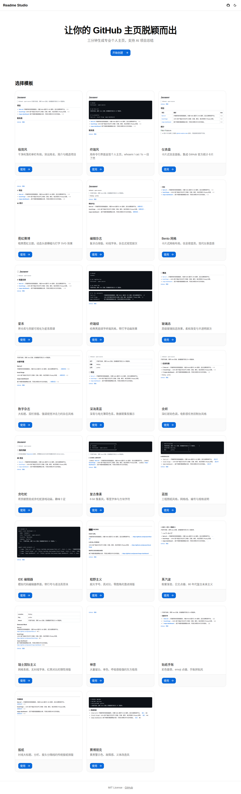
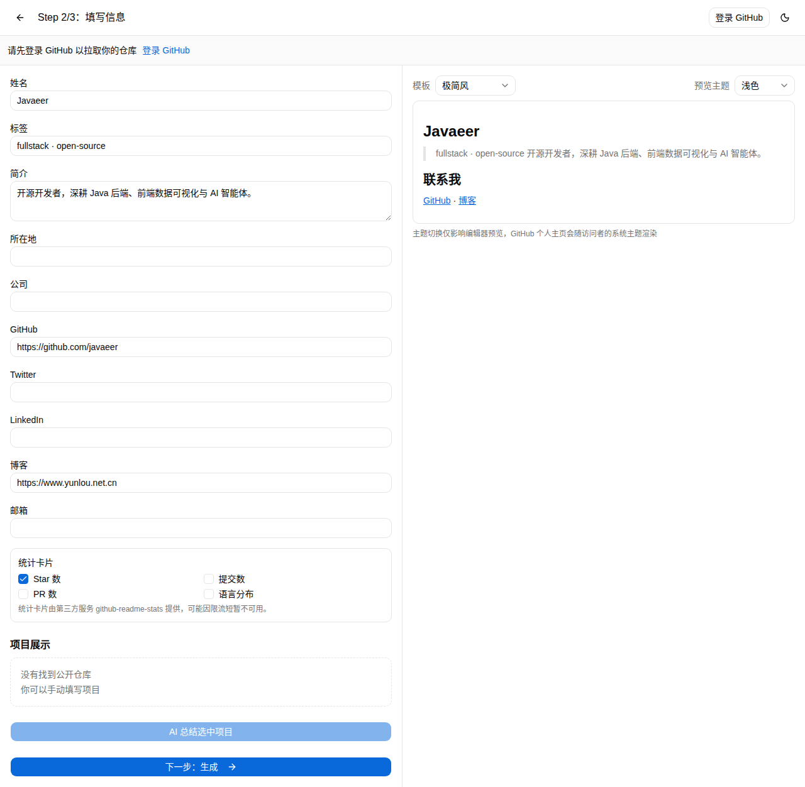
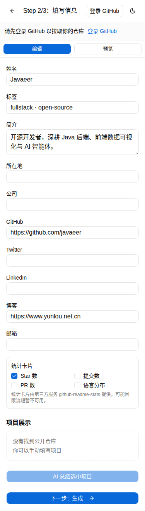
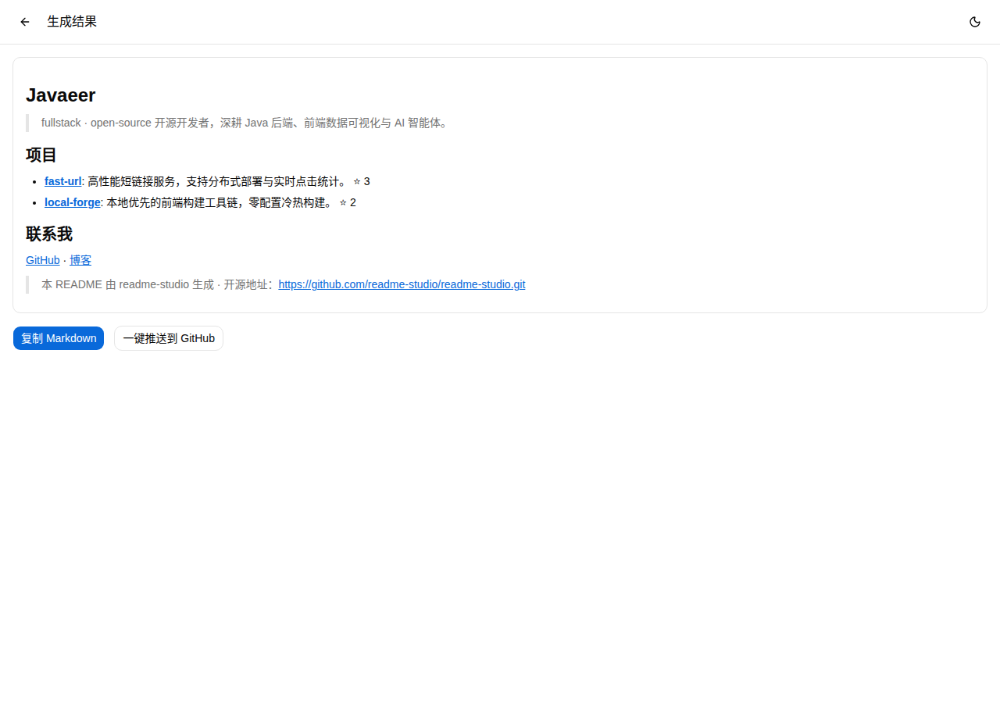

# Readme Studio

> **把 GitHub 账号变成一块门面 —— 几分钟生成漂亮、动态、个性化的 Profile README。**

[](https://github.com/readme-studio/readme-studio/stargazers)
[](LICENSE)
[](https://github.com/readme-studio/readme-studio/actions)
[](https://readme-studio-sigma.vercel.app)
[](https://nextjs.org)

**选模板 → 填资料（或让 AI 总结你的仓库）→ 实时预览 → 一键发布到 GitHub 主页。** 不用碰命令行，不用折腾 Token，全程在浏览器里完成。

---

## 为什么要用 Readme Studio？

你的 GitHub 主页是开源世界里第一眼看到的"简历"，但 90% 的开发者主页长这样：一行默认文案 + 几个死板的列表。Readme Studio 解决的问题很简单——

1. **没时间写**：让 AI 把你的项目总结成一句句人话；
2. **不会设计**：23 套专业模板，从极简到赛博朋克，总有适合你的；
3. **不敢发布**：一键安全发布，通过 GitHub OAuth，不需要勾选一堆吓人的权限。

## 效果预览

| 首页 / 模板画廊 | 编辑器（桌面分栏） | 编辑器（移动端） | 生成的个人主页 |
| --- | --- | --- | --- |
|  |  |  |  |

已完成 375px / 768px / 1280px 响应式验证；可访问性经 axe-core 检测，核心页面 **0 critical / 0 serious** 违规。

## 23 套模板

minimal · paper · swiss · terminal · terminalGreen · ide · bento · magazine · newspaper · retro · sticker · ember · zen · aqua · galaxy · blueprint · brutalist · cyberpunk · neon · vaporwave · glassmorphic · dashboard · snake —— 覆盖极简、终端、杂志、仪表盘、玻璃拟态等风格，输入即预览。

## ✨ 核心特性

- **🤖 AI 项目总结** — 为每个精选仓库生成一句干净介绍。默认 OpenAI `gpt-4o-mini`，支持 BYOK（OpenAI / Gemini / Claude），也支持任意 OpenAI 兼容服务（DeepSeek、SiliconFlow 等）；**不配密钥自动回退本地 Ollama，零费用试用**。
- **🧩 23 套模板** — 风格跨度大，实时预览，发布前可分别检查浅色 / 深色主题效果。
- **🚀 一键发布** — GitHub OAuth 登录后直接写入你的主页仓库；兼容官方 OAuth 流程，高级用户可用 PAT 兜底。
- **🌐 中英双语 UI** — English / 中文，随浏览器语言自动切换。
- **📱 全端适配** — 桌面、平板、手机都能流畅编辑。
- **🔒 权限克制** — 默认路径只申请发布主页 README 的最小权限，不向小白索要宽泛 Token。

## 30 秒上手

1. 打开 **[在线 Demo](https://readme-studio-sigma.vercel.app)**；
2. 登录 GitHub，选模板，让 AI 总结你的仓库（或手动填）；
3. 预览 → 发布，完成。

想要自己部署？见下方 [快速开始（本地开发）](#快速开始本地开发)。更详细的用户指南见 [`docs/user-guide.md`](docs/user-guide.md)。

## 技术栈

Next.js 15（App Router）· React 19 · TypeScript · Tailwind CSS v4 · shadcn/ui · Auth.js（GitHub OAuth）· Octokit · next-intl（i18n）· react-markdown · zod · Vitest + GitHub Actions CI。

## 快速开始（本地开发）

### 环境要求

- Node.js 20+
- pnpm
- 一个 GitHub OAuth App（见下文）

### 1. 安装

```bash
git clone https://github.com/readme-studio/readme-studio.git
cd readme-studio
pnpm install
```

### 2. 配置环境变量

复制 `.env.example` 为 `.env.local` 并填写：

```bash
cp .env.example .env.local
```

| 变量 | 是否必填 | 说明 |
| --- | --- | --- |
| `GITHUB_CLIENT_ID` | ✅ | GitHub OAuth App Client ID |
| `GITHUB_CLIENT_SECRET` | ✅ | GitHub OAuth App Client Secret |
| `AUTH_SECRET` | ✅ | Auth.js 会话加密密钥（任意长随机串） |
| `OPENAI_API_KEY` | ⬜ | 启用服务端 AI 总结；不填则回退本地 Ollama |
| `OPENAI_BASE_URL` | ⬜ | 指向任意 OpenAI 兼容服务（如 DeepSeek、SiliconFlow） |
| `UPSTASH_REDIS_REST_URL` / `UPSTASH_REDIS_REST_TOKEN` | ⬜ | 生产环境按 IP 的每日限额 |
| `NEXTAUTH_URL` | ⬜ | 部署后的公网地址（生产环境填写） |

> **注意**：部署到 Vercel 时环境变量要设在 **Vercel 项目设置**里，而不是仓库内的 `.env.local`。`GITHUB_CLIENT_ID` / `GITHUB_CLIENT_SECRET` / `AUTH_SECRET` 三者缺一不可，否则登录会报 `error=Configuration`（HTTP 500）。

### 3. 创建 GitHub OAuth App

1. GitHub → Settings → Developer settings → OAuth Apps → **New OAuth App**
2. **Homepage URL**: `http://localhost:3000`
3. **Authorization callback URL**: `http://localhost:3000/api/auth/callback/github`
4. 将生成的 **Client ID** 与 **Client Secret** 填入 `.env.local`。

### 4. 启动

```bash
pnpm dev
```

打开 `http://localhost:3000`。

## 部署到 Vercel

1. 在 [vercel.com/new](https://vercel.com/new) 导入仓库；
2. 按上表在 Vercel 项目环境变量中配置；生产环境建议使用**独立的 OAuth App**，并将 `NEXTAUTH_URL` 设为你的 Vercel 域名；
3. 在生产 OAuth App 中，将回调地址设为 `https://<你的域名>/api/auth/callback/github`；
4. 部署后按以下清单做端到端验证：

- [ ] 打开 `https://<你的域名>`，模板正常加载
- [ ] GitHub 登录后能无报错跳转回来
- [ ] 生成并发布 README，`https://github.com/<你>/<你>` 被更新
- [ ] `NEXTAUTH_URL` 与生产域名完全一致（结尾不带斜杠）

## PAT 权限说明（高级 / 兜底）

一键发布默认走 GitHub OAuth，无需 Token。若使用 PAT 兜底，请创建**细粒度**或**经典** Token 并授予：

- `Contents: write` — 创建 / 更新你的个人主页 README
- `Workflows: write`（仅在使用 Actions 统计卡片时需要）— 可选

> 默认走 OAuth 是为了避免向小白索取权限过宽的 Token。

## 外部依赖说明（如实告知）

- **统计卡片**（dashboard 模板）由第三方服务 [github-readme-stats](https://github.com/anuraghazra/github-readme-stats) 提供，限流时可能短暂不可用，不影响 README 其余部分。
- **AI 总结** 调用外部大模型：配置 `OPENAI_API_KEY` 时使用 `gpt-4o-mini`，或使用你提供的 BYOK 服务商；无密钥时回退本地 Ollama。

## 想支持这个项目？

- ⭐ **给仓库点个 Star** —— 这是对独立开发者最大的鼓励；
- 🐛 遇到问题提 [Issue](https://github.com/readme-studio/readme-studio/issues)；
- 🔧 想贡献代码，欢迎提 [Pull Request](https://github.com/readme-studio/readme-studio/pulls)；
- 💬 用了之后把主页截图发出来，让更多人看到你的新门面。

## License

[MIT](LICENSE)

---

# Readme Studio（中文）

> **把你 GitHub 账号的门面，三分钟搞定。** AI 总结 + 23 套模板 + 一键发布。

Readme Studio 是一个 Web 应用，帮助你把 GitHub 账号变成一份漂亮的个人主页 README：选模板 → 填写资料（或让 AI 总结仓库）→ 实时预览 → 登录 GitHub 一键发布，小白无需折腾 Token。

## 效果截图

| 首页 / 模板画廊 | 编辑器（桌面分栏） | 编辑器（移动端） | 生成的个人主页 |
| --- | --- | --- | --- |
|  |  |  |  |

## 核心特性

- **AI 项目总结** — 为每个精选仓库生成一句简介；支持 OpenAI / Gemini / Claude（BYOK）与任意 OpenAI 兼容服务，无密钥时回退本地 Ollama，零费用试用。
- **23 套模板** — minimal、terminal、dashboard、neon、glassmorphic 等，实时预览，发布前可切换明暗主题检查。
- **一键发布** — GitHub OAuth 登录后直接发布到主页仓库；高级用户可用 PAT 兜底。
- **小白友好** — 全流程在浏览器内完成，无需命令行。
- **中英双语界面** — English / 中文。
- **响应式 + 可访问性** — 375px / 768px / 1280px 已验证；axe-core 0 个 critical/serious 违规。

## 技术栈

Next.js 15（App Router）· React 19 · TypeScript · Tailwind CSS v4 · shadcn/ui · Auth.js（GitHub OAuth）· Octokit · next-intl · react-markdown · zod · Vitest + GitHub Actions CI。

## 快速开始（本地开发）

环境要求：Node.js 20+、pnpm。

```bash
git clone https://github.com/readme-studio/readme-studio.git
cd readme-studio
pnpm install
cp .env.example .env.local
# 填写 GITHUB_CLIENT_ID / GITHUB_CLIENT_SECRET / AUTH_SECRET
pnpm dev
```

打开 `http://localhost:3000`。OAuth App 配置与 Vercel 部署步骤详见上方英文版（步骤完全一致）。

## 外部依赖说明（如实告知）

- dashboard 模板的统计卡片由第三方服务 [github-readme-stats](https://github.com/anuraghazra/github-readme-stats) 提供，限流时可能短暂不可用；
- AI 总结调用外部大模型（默认 `gpt-4o-mini` 或 BYOK），无密钥时回退本地 Ollama。

## License

[MIT](LICENSE)